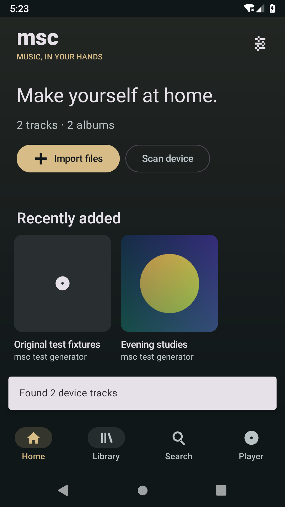
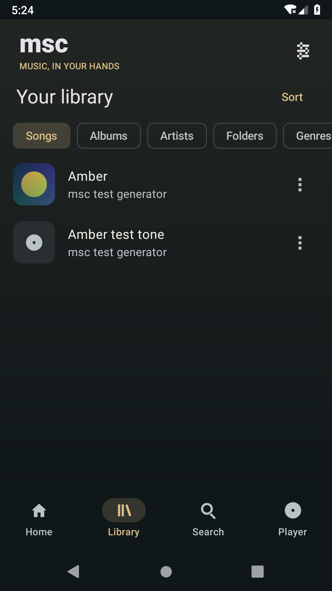
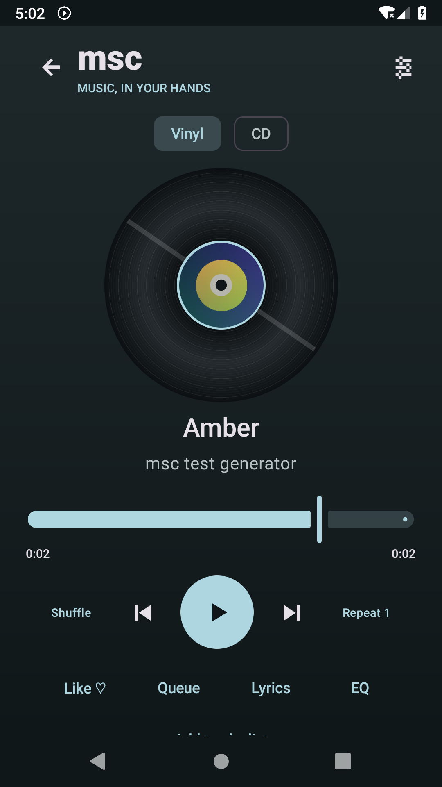
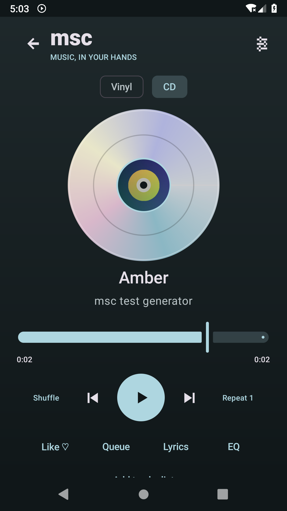
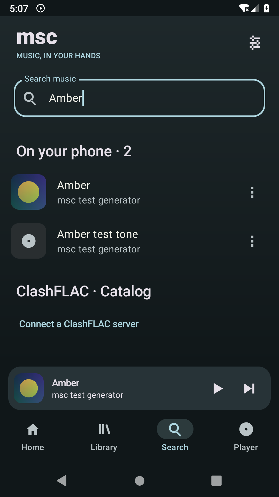
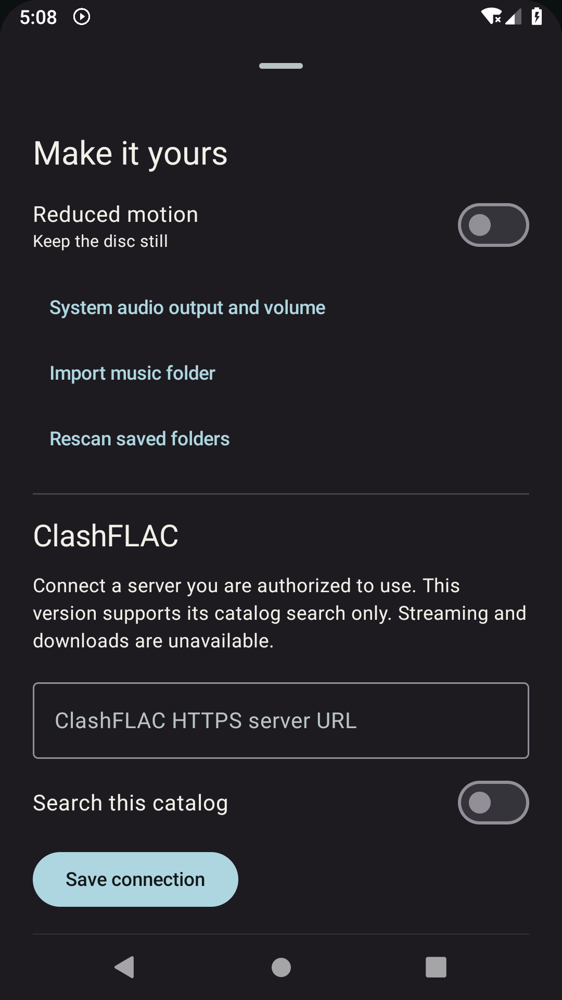

# msc

An Android music player for your own files, with switchable vinyl and CD views. **0.2.0 is a debug local-player build, not the complete release described in the original product plan.**

Download [msc-0.2.0-local-debug.apk](releases/msc-0.2.0-local-debug.apk), or browse [releases/](releases/) for SHA-256 checksums and test evidence. Install it over the earlier build to replace the foundation screen.

## Listening

Use **Import files** to select audio without broad storage access, or **Scan device** to allow Android music-library access. You can import an entire folder from Settings and rescan saved folders. Tap a track to play it; the mini player and Player screen control the same Media3 service. The player supports queue editing, seeking, shuffle/repeat, background media notifications, artwork-based colors and vinyl/CD presentation. Playback does not require an account or network.

Create and edit playlists in Library; a track’s menu adds it to a playlist, the queue or favorites. Import your own LRC/text lyrics from the Player’s Lyrics sheet. Audio effects use the device's actual equalizer/bass capabilities and explain unsupported outputs. Permission and codec support depend on the Android device. Removing a library entry never deletes the original file.

## Screenshots

Captured from the real Android emulator using original test audio/artwork. Demo tracks are not bundled with the app.

| Home | Library |
| :---: | :---: |
|  |  |
| Vinyl player | CD player |
|  |  |
| Search | Settings and ClashFLAC |
|  |  |

## ClashFLAC

Settings accepts an HTTPS ClashFLAC server URL and an explicit catalog-search toggle. The adapter implements the documented `GET /api/search?q=...&limit=20` metadata contract. No hosted server is bundled or assumed. Server authorization and catalog access must already be configured by its operator. Results are labeled **catalog only**; streaming and downloads are unavailable because permitted playback/download contracts have not been established. See [provider audit](docs/PROVIDER_AUDIT.md).

## Development

Use JDK 21 and Android SDK 36/build tools 36.0.0. Minimum Android API 26. The application ID defaults to `org.msc.app`; override with `-Pmsc.applicationId=your.package`.

```
./gradlew :app:testDebugUnitTest :app:lintDebug :app:assembleDebug :app:assembleDebugAndroidTest
./gradlew :app:connectedDebugAndroidTest
python3 scripts/verify_android_results.py
```

Delete only generated `app/build/outputs/androidTest-results/connected` before a fresh connected run. The verifier rejects an empty, failed or skipped suite. The debug APK is `app/build/outputs/apk/debug/app-debug.apk`; `adb install --no-streaming -r <apk>` installs it. Launch with `adb shell am start -n org.msc.app/.MainActivity`.

See [architecture](docs/ARCHITECTURE.md), [test report](docs/TEST_REPORT.md), [build/release instructions](docs/BUILD_AND_RELEASE.md) and [remaining acceptance plan](docs/TEST_PLAN.md). Crossfade, verified gapless timing, authorized online playback/downloads, embedded lyrics extraction and the full device/accessibility matrix remain outstanding. No bit-perfect, acoustic-output or production-signing claim is made.

## Privacy and licensing

Music permission is used only for MediaStore scans; the system picker grants access to selected files/folders. INTERNET is used only for an enabled ClashFLAC catalog connection. No account, analytics or remote backend is required for local music. Imported audio is read, never rewritten. MIT source license; original test tones/artwork are generated test material, not bundled commercial music. Never commit signing keys or provider credentials.
