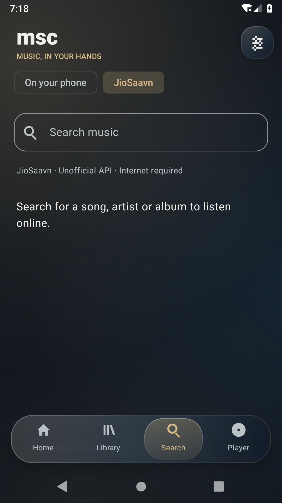

# msc

An Android music player with liquid glass styling, switchable vinyl/CD views, local playback and an experimental JioSaavn online search and streaming source.

Download [msc-0.3.0-online-alpha-debug.apk](releases/msc-0.3.0-online-alpha-debug.apk), or browse [releases/](releases/) for checksums, test evidence and the previous local-player APK. Install over the earlier msc build. **This is a debug alpha: live JioSaavn access could not be verified from the cloud worker, which returned HTTP 403.**

## Online music and liquid glass

Choose **Explore JioSaavn** on Home, or **Search → JioSaavn**. Search a song, artist or album, then tap a playable result. The same Media3 player handles streaming, queue controls, seeking and background playback. No API key or account is bundled. JioSaavn is accessed through the public unofficial `saavn.dev` API; service and regional availability can change. This build does not include YouTube Music.

The new UI has translucent panels, soft artwork-colored light, a floating glass navigation bar, a sliding selection capsule, spring press feedback and short page fades. Reduced motion disables the new movement and disc rotation. Styling uses gradients and borders without expensive live background blur. Smoothness across physical devices has not been profiled.

Online songs use the best HTTPS stream URL supplied by the API and show its reported quality. They are not saved as downloads or added to local favorites/playlists. Online queues last for the active playback session; search again after the service exits or a link expires. Local files still work offline.

## Listening

Use **Import files** to select audio without broad storage access, or **Scan device** to allow Android music-library access. You can import an entire folder from Settings and rescan saved folders. Tap a track to play it; the mini player and Player screen control the same Media3 service. The player supports queue editing, seeking, shuffle/repeat, background media notifications, artwork-based colors and vinyl/CD presentation. Playback does not require an account or network.

Create and edit playlists in Library; a track’s menu adds it to a playlist, the queue or favorites. Import your own LRC/text lyrics from the Player’s Lyrics sheet. Audio effects use the device's actual equalizer/bass capabilities and explain unsupported outputs. Permission and codec support depend on the Android device. Removing a library entry never deletes the original file.

## Screenshots

Captured from the real Android emulator using original test audio/artwork. Demo tracks are not bundled with the app. The online screenshot shows the actual search screen, not a fabricated live catalog.

| Home | Library |
| :---: | :---: |
|  |  |
| Vinyl player | CD player |
|  |  |
| Search | Settings and ClashFLAC |
|  |  |
| JioSaavn search | |
|  | |

## ClashFLAC

Settings accepts an HTTPS ClashFLAC server URL and an explicit catalog-search toggle. The adapter implements the documented `GET /api/search?q=...&limit=20` metadata contract. No hosted server is bundled or assumed. Server authorization and catalog access must already be configured by its operator. Results are labeled **catalog only**; streaming and downloads are unavailable because permitted playback/download contracts have not been established. See [provider audit](docs/PROVIDER_AUDIT.md).

## Development

Use JDK 21 and Android SDK 36/build tools 36.0.0. Minimum Android API 26. The application ID defaults to `org.msc.app`; override with `-Pmsc.applicationId=your.package`.

```
./gradlew :app:testDebugUnitTest :app:lintDebug :app:assembleDebug :app:assembleDebugAndroidTest
./gradlew :app:connectedDebugAndroidTest
python3 scripts/verify_android_results.py
```

Delete only generated `app/build/outputs/androidTest-results/connected` before a fresh connected run. The verifier rejects an empty, failed or skipped suite. The debug APK is `app/build/outputs/apk/debug/app-debug.apk`; `adb install --no-streaming -r <apk>` installs it. Launch with `adb shell am start -n org.msc.app/.MainActivity`.

See [architecture](docs/ARCHITECTURE.md), [test report](docs/ONLINE_TEST_REPORT.md), [build/release instructions](docs/BUILD_AND_RELEASE.md) and [remaining acceptance plan](docs/TEST_PLAN.md). Live provider availability, downloads, crossfade, verified gapless timing, embedded lyrics extraction and the full device/accessibility matrix remain outstanding. No bit-perfect, acoustic-output or production-signing claim is made. The separate [embedded-clash branch](https://github.com/xonix97/msc/tree/embedded-clash) retains the experimental on-device ClashFLAC port.

## Privacy and licensing

Music permission is used only for MediaStore scans; the system picker grants access to selected files/folders. Choosing JioSaavn sends search terms to `saavn.dev` and requests artwork/audio from JioSaavn CDN hosts. An enabled ClashFLAC connection sends catalog searches to its configured server. No account, analytics or remote backend is required for local music. Imported audio is read, never rewritten. MIT source license; original test tones/artwork are generated test material, not bundled commercial music. Never commit signing keys or provider credentials. The debug build permits HTTP only on `127.0.0.1` for controlled emulator tests; public provider requests and returned media URLs require HTTPS.
